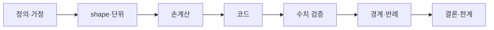

# 검증 프로토콜

`concept-verifier` 에이전트를 띄워 7단계를 집행한다.

## 쓰는 때

- 수식이 이해된 것 같은데 확신이 안 설 때
- 구현이 돌아가는데 맞는지 모를 때 (특히 7~9주 tokenizer·attention)
- 주차 노트 3절·6절을 채울 때

## 진행

인자로 대상을 받는다 — `/verify scaled dot-product attention`,
`/verify llm-from-scratch/attention.py`.

없으면 최근 주차 노트의 3절·5절에서 검증 대상을 찾아 확인받는다.

## 출력

7단계 각각에 **통과 / 미통과 / 해당없음** 과 근거. 미통과면 다음 행동 한 줄.
전부 통과했을 때만 "검증됨".

마지막에 **한계** — 어떤 가정 아래 성립하며, 그 가정이 깨지는 상황은 무엇인가.

## 결과 반영

통과한 손계산과 반례를 주차 노트 **3절(수식)** 과 **6절(검증 계획)** 표에 옮긴다.
`docs/weekly/` 의 해당 파일을 직접 고친다.

> **테스트 통과는 증명이 아니다.** 반례를 못 찾았다는 뜻이고, 그 사실을 7절에 적는다.
