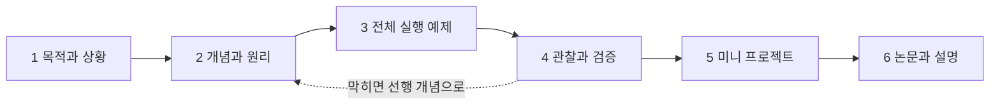
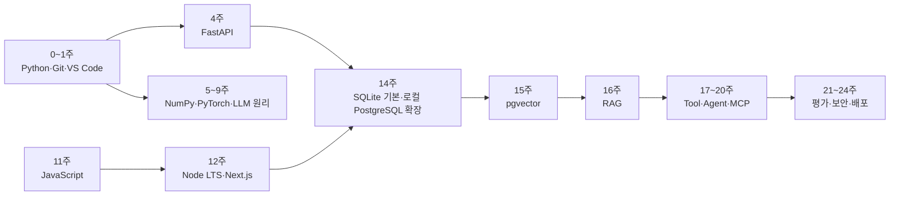
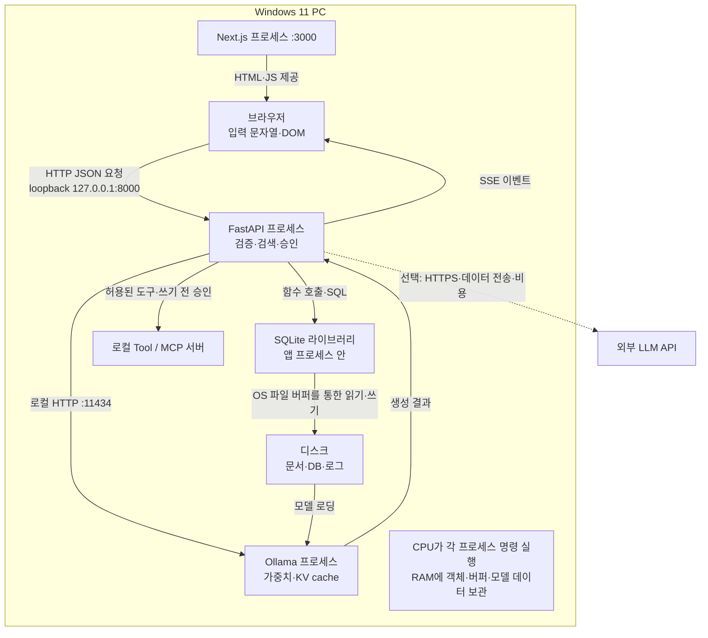
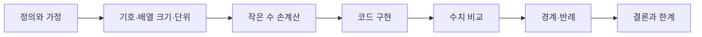

<!-- 이 파일은 Notion 로드맵을 Markdown 으로 옮긴 것이다.
     원문: refs/notion/로드맵_전문_20261015.md (Notion 에서 내보낸 날짜별 사본)
     원문에서 PC별 설치 현황(절대경로 포함)과 날짜별 변경 기록만 뺐다.
     Notion 이 갱신되면 손으로 맞추지 말고 새 사본을 내보낸 뒤 다시 변환할 것. -->

# LLM·Agentic AI 풀스택 24주 학습 로드맵

> **목표:** LLM의 원리와 코드를 이해하고, 프론트엔드·백엔드·DB·네트워크·배포·Agentic AI를 직접 연결해 실제 앱을 만든다.

> 🧭 **전체 과정의 목표 결과물:** Python으로 토큰화·어텐션을 구현하고, PC 안의 Next.js + FastAPI + 로컬 DB + 로컬 생성기로 스트리밍 RAG/Agent 앱을 만든다. PostgreSQL·pgvector·Docker·실제 로컬 LLM은 단계적으로 연결하며 공개 배포와 외부 API는 선택 확장이다.

> 🖼 그림 `roadmap-overview.png` — 24주 한눈에 보기 · 다섯 단계와 주차별 핵심 산출물이다. 노란 테두리는 포트폴리오 산출물을 뜻한다.

# 🚦 여기서 시작하기

0\~24는 학습 **순서**이며 기간 제한이 아니다. 한 장을 정해진 시간 안에 끝낼 필요는 없다. 개념·손계산·코드·실패 원인을 설명하고 재현할 수 있을 때 다음 장으로 이동한다. 진도표의 권장 시간은 완료 조건으로 사용하지 않는다.

1. **환경 확인** — [선수 · 선수 기초 진단과 학습 환경](https://app.notion.com/p/3e22eac098bd8113a7bad22f8d505017). 개발 환경을 확인한다. Python·터미널이 익숙하면 진단만 통과하고 1주차로 이동한다.
2. **첫 실습** — [1주 · 개발 환경과 Python](https://app.notion.com/p/3e22eac098bd819ba03ef986daf224b3). **본문**을 읽고 메모 CLI를 실행한다.
3. **진도 기록** — [24주 학습 진도](https://app.notion.com/p/5b844660788c4a76809136851d974c1f). 전체 차례와 주차별 진도가 있다.

## 한 장을 공부하는 순서

각 주차 페이지는 맨 위의 **본문**이 우선 학습 경로다. 본문은 아래 여섯 단계로 읽고 실습한다.



| 단계 | 본문에서 읽을 것 | 내가 할 일 |
|---|---|---|
| **1 목적과 상황** | 이 장이 앞 장의 어떤 한계를 해결하는지 읽는다. 입력과 최종 결과를 먼저 그려 본다. | 핵심 질문에 먼저 답해 본다. |
| **2 개념과 원리** | 새 용어가 데이터 흐름의 어디에 놓이는지 확인한다. 수식은 기호·배열 크기·단위·가정을 읽고 작은 숫자를 대입한다. | 이론을 읽고 용어를 내 말로 바꾼다. 수식을 작은 숫자로 손계산한다. |
| **3 전체 실행 예제** | VS Code에 지정된 파일을 만들고 해당 명령을 터미널에서 실행한다. 코드 설명을 읽으며 변수 값과 제어 흐름을 따라간다. | 최소 코드를 직접 입력한다. |
| **4 관찰과 검증** | 예상 출력과 실제 출력을 비교한다. 빈 입력·틀린 타입·권한 없음·연결 중단 등 해당 장의 실패도 넣어 본다. | 정상·경계·실패 테스트를 실행한다. |
| **5 미니 프로젝트** | 함수를 분리하거나 실제 DB·모델·UI를 연결한다. 본문의 작은 실습과 최종 확장 기능을 구분해 완료를 기록한다. | 그래프·로그·trace를 근거로 결론을 쓴다. |
| **6 논문과 설명** | 해당 장의 논문 제목·링크·읽을 부분·확인 질문을 사용한다. | 논문을 읽고 자신의 코드 어느 부분과 연결되는지 설명한다. |

> 💻 **실습 경로:** `ai-learning` 폴더를 VS Code로 연다 → `Terminal > New Terminal` → 해당 주차 폴더에서 명령 실행 → 출력/오류 확인 → `python -m pytest -q` 또는 해당 주차의 검증 명령 실행. 명령의 기준 폴더는 주차 페이지에 적혀 있다. 설치 명령은 운영체제와 공식 문서에 맞춰 확인한다.

## 진도와 완료를 기록하는 기준

**진도표의 네 가지 체크**
- **이론:** 다른 사람에게 설명 가능
- **코드:** 예제 없이 재구현
- **검증:** 실패 사례까지 통과
- **회고:** 선택 이유와 다음 개선 기록

**학습 운영 방식**
- **시간 제한 없음:** 개념 설명·손계산·구현·실패 검증을 충분히 반복하고 이해를 기준으로 진도를 정한다.
- **완료 조건:** 설명 가능 + 코드 실행 + 테스트 + 화면/로그 + README + 입력이 어느 프로세스·메모리·파일·소켓을 거쳤는지 설명
- **학습 원칙:** 예제를 복사한 뒤 반드시 기능 하나를 바꾸고, 오류 원인과 해결 과정을 기록한다.
- **AI 활용:** 먼저 가설을 세운 다음 힌트·코드 리뷰·테스트 생성을 요청한다.

0장에 남아 있는 설치·실행 체크는 기존 기록이다. 새로운 PC 관찰 실습과 1\~24장 전체 완료를 뜻하지 않는다. 이론·코드·검증·회고는 직접 확인한 증거로 각각 기록한다.

### 이해도 평가

| 수준 | 판정 |
|---|---|
| 1 기억 | 용어를 정의한다. |
| 2 이해 | 왜 필요한지 자신의 말로 설명한다. |
| 3 적용 | 예제 없이 작은 기능을 구현한다. |
| 4 분석 | 로그와 통신 흐름으로 오류를 찾는다. |
| 5 설계 | 보안·비용·성능 trade-off를 근거로 선택한다. |

### 매주 반복 체크리스트
- [ ] 핵심 개념을 내 말로 5문장 정리
- [ ] 예제를 직접 입력하고 실행
- [ ] 미니 프로젝트 또는 기능 완료
- [ ] 테스트와 예상 결과 기록
- [ ] 오류 원인과 해결 과정 기록
- [ ] Git 커밋·README 업데이트
- [ ] 다음 주 질문 3개 작성

### 진도 조정
- Python이 처음이면 0\~4장의 변수·함수·파일·요청 흐름을 스스로 설명하고 재현할 때까지 반복한다.
- 웹 경험이 있어도 11\~12장의 상태·통신·오류 처리 검증을 통과한 뒤 이동한다.
- 수학에서 막히면 증명보다 작은 수와 tensor shape로 먼저 검증한다.
- 한 장에 필요한 기간을 자유롭게 사용하고, 막힌 선행 개념으로 돌아가 보완한다.
- 라이브러리 암기보다 HTTP·상태·데이터 흐름·평가 원리를 우선한다.

## 첫 주 시작 체크리스트
- [x] Python·Git·VS Code 설치와 버전 확인
- [x] `ai-learning` Git 저장소 생성
- [ ] Python 가상환경과 의존성 파일 생성
- [ ] 파일 기반 CLI 메모 앱 구현
- [ ] 정상·빈 입력·없는 메모 테스트
- [ ] README에 실행법·구조·배운 점 작성
- [ ] GPT 프로젝트 생성 후 아래 지침 등록

> ✅ **1주차 종료 질문:** 터미널 명령을 입력했을 때 OS가 실행 파일을 찾아 프로세스로 실행하는 과정을 말로 설명할 수 있는가?

# 🗺️ 24주 로드맵

> 🎞 영상 `app-growth.mp4` (GIF `app-growth.gif` 도 있음) — 24주 동안 앱이 자라는 과정 (42초) · 포트폴리오 산출물마다 어떤 부품이 더해지는지 보여 준다. 초록 테두리가 그 단계에 새로 만드는 부분이다.

## 다섯 단계와 포트폴리오

| 단계 | 주차 | 핵심 결과물 | 포트폴리오 산출물 |
|---|---|---|---|
| **1 컴퓨팅·웹 기초** | 0–4 | 터미널·Python·자료구조·네트워크·CRUD API | **4주:** FastAPI 메모 CRUD — HTTP, REST, pytest |
| **2 ML·LLM 원리** | 5–10 | 경사하강·역전파·tokenizer·attention·LLM API | **10주:** CLI LLM 챗봇 — 프롬프트, 구조화 출력, 비용·오류 처리 |
| **3 풀스택 LLM 앱** | 11–14 | Next.js UI·streaming·SQLite 기본·로컬 PostgreSQL/인증 확장 | **14주:** 로컬 대화 저장 — SQLite로 시작, Next.js·SSE·PostgreSQL·실제 인증은 연결 단계별 검증 |
| **4 RAG·Agent** | 15–20 | 검색·RAG·도구·agent loop·MCP | **16주:** 출처 기반 문서 Q&A — embedding, vector search, RAG<br>**20주:** 승인 가능한 업무 에이전트 — tools, workflow, MCP, trace |
| **5 품질·보안·배포** | 21–24 | 평가·위협 모델·CI/CD·최종 프로젝트 | **24주:** PC에서 재현 가능한 AI 앱 — 보안·평가·재시작·복구, Docker/외부 CI/CD는 선택 |

## 주차별 상세 로드맵

주차 이름을 누르면 상세 학습 페이지로 이동한다.

### 1단계 · 0\~4주 — 컴퓨팅·웹 기초

포트폴리오 ①은 4주의 **FastAPI 메모 CRUD**다.

| 주차 | 개념 | 실습 | 완료 기준 |
|---|---|---|---|
| [**0 · 선수 기초 진단**](https://app.notion.com/p/3e22eac098bd8113a7bad22f8d505017) | 파일·프로그램·프로세스, 작업 폴더, 가상환경, RAM과 디스크 | 실행 환경 확인, PID와 RAM 60초 관찰 | 진단표·개발환경·첫 실행 로그 |
| [**1 · 개발 환경과 Python**](https://app.notion.com/p/3e22eac098bd819ba03ef986daf224b3) | OS·프로세스·터미널·환경변수, 변수·조건·반복·함수 | CLI 메모 앱, Git 첫 커밋 | 터미널 실행·예외 처리·README |
| [**2 · 자료구조와 알고리즘**](https://app.notion.com/p/3e22eac098bd8124a703ca24964568a3) | list/dict/set, 스택·큐, Big-O, 클래스·모듈 | 단어 빈도 분석기와 LRU 캐시 | 입력 크기별 처리시간 비교 |
| [**3 · 네트워크와 웹**](https://app.notion.com/p/3e22eac098bd81b9856ee3a521cc01bf) | IP·포트·DNS·TCP/UDP·TLS·HTTP·쿠키·JSON | curl API 호출, socket 에코 서버, 개발자도구 관찰 | 브라우저→서버 흐름 설명 |
| [**4 · 백엔드 API**](https://app.notion.com/p/3e22eac098bd81188b9ec3270789103c) | REST·라우팅·상태코드·직렬화·동기/비동기 | FastAPI 메모 CRUD와 pytest | CRUD·오류 테스트 통과 |

### 2단계 · 5\~10주 — ML·LLM 원리

포트폴리오 ②는 10주의 **CLI LLM 챗봇**이다.

| 주차 | 개념 | 실습 | 완료 기준 |
|---|---|---|---|
| [**5 · ML 수학 기초**](https://app.notion.com/p/3e22eac098bd81e3a7dfe00f86a41161) | 벡터·행렬·내적·확률·손실·경사하강법·과적합 | NumPy 선형회귀 | 학습률별 손실 해석 |
| [**6 · 신경망과 PyTorch**](https://app.notion.com/p/3e22eac098bd81ef8e90e450b1431525) | 활성화·역전파·batch·epoch·optimizer | 분류 모델과 train/validation | forward/backward 설명 |
| [**7 · 토큰과 임베딩**](https://app.notion.com/p/3e22eac098bd8130a5c5fbd050c44890) | BPE·token ID·embedding·context·cosine similarity | 문자 tokenizer와 유사도 검색 | 토큰화 방식 비교 |
| [**8 · Attention·Transformer**](https://app.notion.com/p/3e22eac098bd81928293fbb6366363d5) | Q/K/V·scaled attention·mask·positional encoding | single-head attention 직접 구현 | tensor shape·causal mask 검증 |
| [**9 · LLM 학습과 추론**](https://app.notion.com/p/3e22eac098bd8126996dc3f24886b5de) | pretraining·SFT·RLHF/DPO·temperature·top-p | CPU bigram 생성 → 소형 로컬 모델 연결 | 샘플링 결과와 환각 분석 |
| [**10 · LLM API·프롬프트**](https://app.notion.com/p/3e22eac098bd8109b9c1fcccf61cf7ae) | role·structured output·tool calling·rate limit·비용 | CLI 챗봇, retry·timeout·비밀키 관리 | JSON 검증·키 유출 방지 |

### 3단계 · 11\~14주 — 풀스택 LLM 앱

Next.js UI·streaming·SQLite 기본·로컬 PostgreSQL/인증 확장. 포트폴리오 ③은 14주의 **로컬 대화 저장**이다.

| 주차 | 개념 | 실습 | 완료 기준 |
|---|---|---|---|
| [**11 · 웹 프론트 기초**](https://app.notion.com/p/3e22eac098bd8135bf55ce73e6a3edad) | HTML·CSS·DOM·event·Promise·fetch·CORS | 채팅 UI와 FastAPI 연결 | loading/error/empty 상태 |
| [**12 · React·Next.js**](https://app.notion.com/p/3e22eac098bd81f785c3c3679c9cd574) | component·props·state·hook·TypeScript·렌더링 | 대화 목록·메시지·설정 패널 | 타입 오류 없는 build |
| [**13 · 스트리밍 통신**](https://app.notion.com/p/3e22eac098bd81cc89c5d997a0cca8c1) | polling·SSE·WebSocket·chunk·backpressure | LLM SSE 스트리밍과 중지 버튼 | 첫 토큰 지연·끊김 처리 |
| [**14 · DB와 인증**](https://app.notion.com/p/3e22eac098bd8107ae60caa210c2feb0) | SQL·index·transaction·ORM·session·JWT·OAuth | SQLite 영속성 기본 → 로컬 PostgreSQL·로그인 확장 | 자기 대화만 조회 |

### 4단계 · 15\~20주 — RAG·Agent

포트폴리오 ④는 16주의 **출처 기반 문서 Q&A**, ⑤는 20주의 **승인 가능한 업무 에이전트**다.

| 주차 | 개념 | 실습 | 완료 기준 |
|---|---|---|---|
| [**15 · 임베딩 검색**](https://app.notion.com/p/3e22eac098bd81d684fad3b5c8cafcf9) | chunking·embedding·top-k·metadata·vector DB | 문서 업로드→분할→검색 | chunk·top-k 품질 비교 |
| [**16 · RAG**](https://app.notion.com/p/3e22eac098bd819386d3e044a6cd0f09) | retrieve→augment→generate·인용·hybrid·rerank | 근거 링크가 있는 문서 Q&A | 모르면 모름·출처 표시 |
| [**17 · 도구 호출**](https://app.notion.com/p/3e22eac098bd813397c9e78ba0a2e308) | schema·validation·권한·idempotency·오류 복구 | 계산기·모의 API·DB 검색 도구 | 잘못된 인자·실패 처리 |
| [**18 · Agentic AI**](https://app.notion.com/p/3e22eac098bd81f7b054e7e0c478455d) | plan/act/observe·state·memory·종료·HITL | 조사 계획과 순차 도구 호출 agent | 반복·비용 제한·승인 |
| [**19 · 워크플로·멀티에이전트**](https://app.notion.com/p/3e22eac098bd81ed8d1cd94b381c336f) | workflow와 agent 차이·supervisor·handoff | 조사자→검증자→작성자 상태 머신 | trace 저장·필요성 판단 |
| [**20 · MCP와 외부 연동**](https://app.notion.com/p/3e22eac098bd81449ca6ddf731ba2972) | host/client/server·resource·tool·OAuth·최소 권한 | 로컬 MCP 서버와 모의 일정/파일 도구 | 읽기/쓰기 분리·쓰기 승인 |

### 5단계 · 21\~24주 — 품질·보안·배포

포트폴리오 ⑥은 24주의 **PC에서 재현 가능한 AI 앱**이다.

| 주차 | 개념 | 실습 | 완료 기준 |
|---|---|---|---|
| [**21 · 테스트·평가·관측**](https://app.notion.com/p/3e22eac098bd8105be74f159d3633e7b) | unit/integration/E2E·golden set·quality·latency·cost | 30개 eval set·회귀 테스트·trace | 변경 전후 결과표 |
| [**22 · 보안과 안전**](https://app.notion.com/p/3e22eac098bd81758974f383a56a9c32) | prompt injection·유출·XSS·CSRF·SQLi·secret | 검증·rate limit·allowlist·감사 로그 | 위협 모델·공격 테스트 |
| [**23 · 배포와 운영**](https://app.notion.com/p/3e22eac098bd81458b70fd668ed9f94c) | 로컬 재현·복구 기본, Docker·DNS·HTTPS·CI/CD 확장 | 내 PC 재시작·health·테스트 → 컨테이너 재현 선택 | 새 환경에서 재현 |
| [**24 · 최종 프로젝트**](https://app.notion.com/p/3e22eac098bd813f922cd01fe2b0d7c3) | 설계·품질·운영·발표 | 개인 지식 기반 AI 업무 도우미 | PC 시연·문서·평가·복구 가이드, 외부 배포 별도 |

## 학습 의존성과 준비 시점



- **Docker는 14장의 PostgreSQL 컨테이너 경로를 선택하기 전에 준비한다.** SQLite 기본 경로는 Docker 없이 진행한다. 23장의 컨테이너 실습에서는 image·network·자원·재시작·rollback을 다루고, 공개 CI/CD는 선택 확장으로 분리한다.
- Node.js는 12주차 Next.js 시작 전에 LTS를 설치한다.
- pgvector index는 처음부터 만들지 않는다. 15주차에는 exact search를 기준으로 정확성을 확인한 뒤 데이터와 측정값이 생겼을 때 HNSW/IVFFlat을 비교한다.

# 🖥️ PC 한 대에서 배우는 실행 경로

**기본 환경은 Windows 11 PC와 VS Code·PowerShell이다.** Jetson, 별도 보드, 센서, 외장 GPU, 유료 LLM API를 필수로 요구하지 않는다. CPU로 작은 입력과 모델을 실행하고, 프로그램·메모리·통신을 관찰한 뒤 확장한다. 설치 파일·패키지·모델을 처음 내려받을 때는 인터넷과 디스크 공간이 필요하다. 내려받은 뒤의 기본 실습은 PC 안에서 진행한다.

**PC 한 대와 완전 오프라인은 구분한다.** 기본 경로는 로컬 파일·`localhost`·로컬 DB·로컬 모델이다. 클라우드 API·외부 검색·OAuth·공개 배포는 선택 확장으로 분리한다. 외부 모델에 연결하면 질문과 첨부 근거가 제공자에게 전송되고 비용·보관 정책·키 관리가 추가된다. FastAPI 기본 `/docs`처럼 화면 자료를 CDN에서 받는 기능은 로컬 API라도 인터넷이 필요할 수 있으므로 4장의 `/openapi.json`·로컬 클라이언트 검증 경로를 함께 사용한다.

> 🖼 그림 `pc-port-map.png` — PC 안의 프로그램과 주소 지도 · 실선은 PC 안의 기본 경로, 점선은 선택 확장이다.

## PC 안의 프로그램과 주소 지도

| 구성요소 | 기본 위치 또는 주소 | 관찰할 것 |
|---|---|---|
| VS Code·PowerShell | 기존 프로젝트 루트 | 현재 폴더, 실행 Python 경로, PID |
| Next.js 개발 서버 | `127.0.0.1:3000` | 브라우저 Network, node 프로세스 |
| FastAPI | `127.0.0.1:8000` | 요청 ID, 라우트, python 프로세스 |
| Ollama 로컬 모델 | `127.0.0.1:11434` | ollama ps, 로딩 시간, 생성 token/s |
| SQLite 기본 저장소 | 프로젝트의 `.sqlite3` 파일 | 같은 앱 프로세스의 SQL 실행, 파일 재조회 |
| PostgreSQL 선택 확장 | `127.0.0.1:5432` | 별도 DB 프로세스, SQL, named volume |
| MCP HTTP 수업 | 본문 기본 8000, FastAPI와 번갈아 실행 | 호스트·클라이언트·서버 PID와 도구 결과 |

이 포트 표는 교재의 예시이며 모두 동시에 켜라는 뜻이 아니다. 주소가 충돌하면 해당 장의 서버 하나만 실행한다. `127.0.0.1`은 이 PC 내부의 loopback 주소다. PC 두 대를 연결하거나 공유기 포트·방화벽을 열 필요가 없다. Windows·WSL·컨테이너는 네트워크 경계가 다르므로 처음에는 Windows 네이티브 Python과 Node를 기준으로 통일한다.

## 무엇을 언제 설치하나

- **0\~4장:** 기존 Python·Git·VS Code를 먼저 확인한다. 작업 관리자와 리소스 모니터로 CPU·RAM·디스크·프로세스를, PowerShell과 브라우저 개발자도구로 요청을 본다.
- **5\~8장:** 작은 배열과 CPU PyTorch로 계산한다. CUDA 설치나 GPU 구입은 선행 조건이 아니다.
- **9\~10장:** 표준 라이브러리 모의 생성기로 계약을 확인하고, 자원이 허용되면 Ollama의 작은 로컬 모델을 연결한다. 설치·모델 다운로드는 공식 경로와 라이선스를 확인하고 직접 진행한다.
- **11\~13장:** 브라우저·Node.js LTS·Next.js와 FastAPI를 같은 PC에서 실행한다. 서로 다른 포트는 서로 다른 프로그램의 진입점이다.
- **14\~16장:** SQLite로 영속성과 SQL을 먼저 재현한다. PostgreSQL·pgvector는 같은 PC의 확장 경로이며 Docker Desktop은 이 경로를 선택할 때 준비한다. Docker/WSL은 첫 Python 실행의 필수 조건이 아니다.
- **17\~24장:** 로컬 도구·승인·MCP·평가를 연결한다. 최종 기본 완료는 내 PC에서 재현되는 앱과 검증 기록이다. 도메인 구입·클라우드 결제·공개 배포는 별도 선택이다.

| 시점 | 도구 | 최소 통과 명령 | 상세 페이지 |
|---|---|---|---|
| 0주 | Python·Git·VS Code | `python --version`, `git --version`, `code --version` | [0주](https://app.notion.com/p/3e22eac098bd8113a7bad22f8d505017) |
| 4주 | FastAPI | `fastapi dev main.py`, `/docs` 확인 | [4주](https://app.notion.com/p/3e22eac098bd81188b9ec3270789103c) |
| 6주 | PyTorch | `import torch`, CPU/GPU 상태 출력 | [6주](https://app.notion.com/p/3e22eac098bd81ef8e90e450b1431525) |
| 9주 | Ollama·소형 로컬 모델 | `ollama --version`, `ollama list`, `/api/tags` 응답 | [9주](https://app.notion.com/p/3e22eac098bd8126996dc3f24886b5de) |
| 12주 | Node LTS·Next.js | `npm run dev`, `npm run build` | [12주](https://app.notion.com/p/3e22eac098bd81f785c3c3679c9cd574) |
| 14주 | SQLite 기본 / Docker·PostgreSQL 선택 | SQLite seed/list/rollback / 선택 Docker·SQL 검증 | [14주](https://app.notion.com/p/3e22eac098bd8107ae60caa210c2feb0) |
| 20주 | MCP SDK·Inspector | tool schema·정상/실패 호출 | [20주](https://app.notion.com/p/3e22eac098bd81449ca6ddf731ba2972) |

## 프로그램 설치 공통 절차

모든 설치 페이지에서 다음 6단계를 완료해야 “설치 완료”로 판정한다.

1. **공식 문서 확인:** 지원 OS·선행 조건·라이선스·최소 버전을 확인한다.
2. **설치:** 기본 경로를 우선하고, 선택한 옵션을 캡처하거나 기록한다.
3. **새 터미널:** PATH 반영을 위해 기존 터미널을 닫고 다시 연다.
4. **검증:** `--version`, Windows에서는 `where.exe 프로그램명`, 실제 runtime 경로를 기록한다.
5. **최소 실행:** Hello World 또는 공식 quickstart를 실행한다.
6. **실패 기록:** 명령, 전체 오류, 예상 결과, 실제 결과, 가설, 다음 검증을 남긴다.

## 저장소와 터미널의 공통 기준

교재의 `ai-learning`은 프로젝트 루트의 예시 이름이다. 0장 기록처럼 기존 `LLM_Study` 저장소를 사용 중이면 그 폴더를 그대로 VS Code로 열고 아래 상대 경로를 만든다. 새 저장소를 중복 생성하거나 기존 파일을 이동할 필요는 없다. 새 본문의 독립 예제는 `lessons/weekNN`에 만들고, 별도 지시가 없으면 **프로젝트 루트의 터미널**에서 명령을 실행한다. 예를 들어 `python lessons/week15/retrieve.py`다. React 앱은 `apps/web`, 최종 API는 `apps/api`를 사용한다. 폴더나 파일이 없으면 VS Code 탐색기에서 먼저 만든다. 명령이 실행 중인 서버 터미널과 다른 명령을 입력할 새 터미널을 구분한다.

가상환경 활성화 후 `python`이 그 환경을 가리키는지 0장의 `sys.executable`로 확인한다. PowerShell 활성화가 어려우면 0장에서 안내한 가상환경 Python의 직접 경로를 사용한다. 운영체제별 차이가 있는 명령은 각 장에서 구분한다.

**저장소 구조**
- `lessons/week00` \~ `lessons/week24`: 본문의 독립 실행 예제
- `apps/web`: Next.js 화면과 브라우저 상태
- `apps/api`: FastAPI·인증·저장소·검색·모델·도구 어댑터
- `tests`: 핵심 함수·API·DB 통합·E2E 검증
- `eval`: 고정 평가 질문·기대 근거·변경 전후 결과
- `docs`: 설계·실행·오류 분석·검증 증거·복구 절차
- `.env.example` / `README.md`: 실제 비밀값 없는 설정 예시 / 전체 실행 안내

**각 주차에 추가로 남길 산출물**
- `environment.md`: OS, runtime, 패키지, 설치 경로, 검증 명령
- `commands.md`: 성공 명령과 실패 명령을 함께 기록
- `tests/`: 정상·경계·실패를 최소 1개씩
- `evidence/`: 그래프, Network 캡처, SQL plan, trace
- `decision-log.md`: 선택지, 선택 이유, 버린 대안, 다시 판단할 조건

기존 파일이 있다면 무작정 이동하지 않고 새 예제와 대응하는 경로를 README에 기록한다.

## 성능과 진도 기록 원칙

모델 이름·양자화·문맥 길이·동시 요청 수·CPU/RAM·OS·패키지 버전을 기록한다. 1 MB=1,000,000 bytes, 1 MiB=1,048,576 bytes이며 문자 수·UTF-8 byte 수·token 수는 같지 않다. 모델 파일 크기만으로 실행 RAM을 판단하지 않는다.

# 🔄 전체 시스템과 통신 흐름

> 🎞 영상 `request-flow.mp4` (GIF `request-flow.gif` 도 있음) — 질문 한 번이 PC 안을 지나가는 길 (74초) · 11단계마다 데이터의 형태·위치·처리자·경계·증명 방법이 어떻게 바뀌는지 보여 준다. 멈춰 가며 본다.

## 기본 경로는 PC 안에서 닫힌다



이 그림은 논리적 책임과 데이터 경로다. 상자마다 별도 물리 RAM이 있다는 뜻은 아니다. 각 프로세스의 주소 공간과 OS가 관리하는 실제 메모리, 디스크 캐시를 구분한다. SQLite는 별도 서버 프로세스가 없고, PostgreSQL을 선택하면 별도 DB 프로세스와 연결이 추가된다.

> ➡️ **질문 한 번의 기본 흐름:** 키보드 입력 → 브라우저 문자열 → JSON 직렬화·UTF-8 → loopback 소켓과 OS 버퍼 → FastAPI 역직렬화·검증 → 허용된 문서 검색 → 로컬 모델 tokenizer·입력 처리(prefill)·토큰 생성(decode) → 응답 바이트 → SSE 파서 → 화면 갱신 → 승인된 결과만 DB 저장.

숫자 IP를 직접 쓰는 로컬 HTTP 실습에는 공개 DNS 조회와 TLS가 필수로 들어가지 않는다. 외부 HTTPS를 선택할 때는 이름 해석·보안 연결·인터넷 구간이 추가된다. 실제 HTTP 버전과 연결 재사용에 따라 상세 흐름은 달라진다. 브라우저가 FastAPI에 직접 요청하는 예제는 3000과 8000의 origin 차이 때문에 CORS 설정을 확인한다.

## 같은 데이터에 매번 묻는 다섯 가지

1. **어떤 형태인가:** Python dict, JSON 문자열, UTF-8 바이트, token ID, float32 배열, DB 행을 구분한다.
2. **어디에 있는가:** 디스크 파일, 프로세스 가상 주소 공간, OS 버퍼, DB 버퍼, 모델 RAM/선택 VRAM 중 어디인지 그린다.
3. **누가 처리하는가:** CPU에서 실행되는 어떤 프로세스·스레드인지 적는다. GPU가 없으면 CPU 경로부터 실행한다.
4. **어떤 경계를 넘는가:** 함수 호출, 파일 입출력, 프로세스 간 통신, loopback TCP, 외부 HTTPS를 표시한다. 화살표에 자료형과 byte·token·ms 같은 단위를 붙인다.
5. **어떻게 증명하는가:** print만으로 물리 RAM·디스크 완료를 측정했다고 단정하지 않는다. 예상 모형, 실제 로그, 도구로 측정한 값, 아직 확인하지 못한 항목을 분리한다.

# 📐 수식·증명·코드 검증 프로토콜



1. **정의:** 기호가 무엇을 뜻하는지와 가정을 먼저 적는다.
2. **유도:** 등호 한 줄마다 사용한 법칙을 적는다.
3. **손계산:** 2×2 행렬이나 3개 토큰처럼 작은 입력으로 계산한다.
4. **수치 검증:** analytic 결과와 finite difference·brute force·기준 구현을 비교한다.
5. **반례:** 빈 입력, 0, 매우 큰 값, 잘못된 타입, 연결 끊김을 넣는다.
6. **설명:** 결과가 맞다는 사실과 왜 맞는지, 적용 한계를 분리한다.

> 🧪 **증명보다 검증이 먼저 필요한 경우:** 수학이 막히면 작은 tensor shape와 숫자로 현상을 확인한 뒤 일반식으로 돌아온다. 단, 코드 결과를 증명으로 착각하지 않고 반례 가능성을 따로 기록한다.

## 수식은 이 순서로 공부한다

| 주차 | 핵심 수식 | 작은 수 검증 | 직관 |
|---|---|---|---|
| 5 | MSE gradient | 점 2\~3개로 analytic vs finite difference | 손실 지형의 내리막 방향 |
| 6 | chain rule | 스칼라 1개 network | 국소 기울기의 곱 |
| 8 | `softmax(QKᵀ/√dₖ+M)V` | 2 tokens × 2 dimensions | 검색 점수→확률→가중합 |
| 9 | temperature·entropy | logits 3개, T=0.5/1/2 | 분포의 뾰족함 조절 |
| 15\~16 | cosine·Recall@k | 3차원 vectors 3개 | 가까운 근거를 찾는 단계 |
| 21 | precision·recall·p95 | 작은 confusion matrix·latency 20개 | 평균에 가려진 실패 분리 |

# 📚 논문과 영상

## 주차별 논문 읽기 지도

**처음부터 완독하지 않는다.** 해당 주차의 작은 코드 실행 → 초록 → 핵심 방법 그림/수식 → 결과 표 하나 → 확인 질문 순서로 읽는다. 핵심 4편은 7·8·16·18주차에, 선택 7편은 관련 실습을 끝낸 뒤 읽는다. 본문 접근 제한이 있는 자료는 초록과 수업 코드로 먼저 진행한다.

| 주차 | 논문 제목·원문 | 권장 시점 |
|---|---|---|
| 6 | [Learning representations by back-propagating errors](https://www.nature.com/articles/323533a0) | 선택 · 역전파 손계산 후 |
| 7 | [Neural Machine Translation of Rare Words with Subword Units](https://arxiv.org/abs/1508.07909) | **핵심** · 문자 tokenizer 실습 후 |
| 8 | [Attention Is All You Need](https://arxiv.org/abs/1706.03762) | **핵심** · 2토큰 계산 후 |
| 9 | [Language Models are Few-Shot Learners](https://arxiv.org/abs/2005.14165) | 선택 · 생성·학습 차이 이해 후 |
| 10 | [Training language models to follow instructions with human feedback](https://arxiv.org/abs/2203.02155) | 선택 · API 챗봇 구현 후 |
| 15 | [Sentence-BERT: Sentence Embeddings using Siamese BERT-Networks](https://arxiv.org/abs/1908.10084) | 선택 · cosine 실습 후 |
| 16 | [Retrieval-Augmented Generation for Knowledge-Intensive NLP Tasks](https://arxiv.org/abs/2005.11401) | **핵심** · 출처 포함 Q&A 후 |
| 17 | [Toolformer: Language Models Can Teach Themselves to Use Tools](https://arxiv.org/abs/2302.04761) | 선택 · 도구 allowlist 구현 후 |
| 18 | [ReAct: Synergizing Reasoning and Acting in Language Models](https://arxiv.org/abs/2210.03629) | **핵심** · 제한 루프 테스트 후 |
| 21 | [Holistic Evaluation of Language Models](https://arxiv.org/abs/2211.09110) | 선택 · 평가표 작성 후 |
| 22 | [Not what you've signed up for: Compromising Real-World LLM-Integrated Applications with Indirect Prompt Injection](https://arxiv.org/abs/2302.12173) | 선택 · 소유권 테스트 후 |

**읽기 메모:** 논문이 해결하는 문제 / 방법을 한 문장으로 / 내 코드의 어느 부분과 연결되는가 / 실험이 보여 주지 못한 것. 각 주차 상단에 읽을 부분과 확인 질문이 있다.

**별도 실무 참고:** [OWASP LLM Top 10](https://genai.owasp.org/llm-top-10/)은 보안 가이드이며 논문과 구분한다. 설치·SDK 사용법은 공식 문서를 우선한다.

## 영상으로 먼저 그림 잡기

논문과 같은 원칙으로 본다. 해당 주차의 작은 코드를 먼저 실행하고, 영상으로 그림을 잡은 뒤, 다시 코드로 돌아와 확인한다. 영상은 본문과 실습을 대신하지 않는다. 아래는 모두 영어 영상이며 자막은 YouTube 설정에서 확인한다.

- 시작 전 · [Large Language Models explained briefly](https://www.youtube.com/watch?v=LPZh9BOjkQs) (3Blue1Brown)
- 7\~8주 · [Transformers, the tech behind LLMs](https://www.youtube.com/watch?v=wjZofJX0v4M) (3Blue1Brown)
- 8주 · [Attention in transformers, step-by-step](https://www.youtube.com/watch?v=eMlx5fFNoYc) (3Blue1Brown)
- 16주 · [What is Retrieval-Augmented Generation (RAG)?](https://www.youtube.com/watch?v=T-D1OfcDW1M) (IBM Technology)

| 주차 | 영상 | 권장 시점 |
|---|---|---|
| 5 | [Gradient descent, how neural networks learn](https://www.youtube.com/watch?v=IHZwWFHWa-w) · 3Blue1Brown | 점 2\~3개 gradient 손계산 후 |
| 6 | [But what is a neural network?](https://www.youtube.com/watch?v=aircAruvnKk) · [Backpropagation, intuitively](https://www.youtube.com/watch?v=Ilg3gGewQ5U) · 3Blue1Brown<br>[The spelled-out intro to neural networks and backpropagation: building micrograd](https://www.youtube.com/watch?v=VMj-3S1tku0) · Andrej Karpathy | 역전파 손계산 후 |
| 7 | [Let's build the GPT Tokenizer](https://www.youtube.com/watch?v=zduSFxRajkE) · Andrej Karpathy | 문자 tokenizer 실습 후 |
| 8 | [Let's build GPT: from scratch, in code, spelled out.](https://www.youtube.com/watch?v=kCc8FmEb1nY) · Andrej Karpathy | 2토큰 계산 후 |
| 9 | [[1hr Talk] Intro to Large Language Models](https://www.youtube.com/watch?v=zjkBMFhNj_g) · [Deep Dive into LLMs like ChatGPT](https://www.youtube.com/watch?v=7xTGNNLPyMI) · Andrej Karpathy<br>[How might LLMs store facts](https://www.youtube.com/watch?v=9-Jl0dxWQs8) · 3Blue1Brown | 생성·학습 차이 이해 후 |

# 🏁 최종 프로젝트: 개인 지식 기반 AI 업무 도우미

> 🖼 그림 `final-app-mock.png` — 최종 프로젝트 완성 화면 예시 · 목표를 그린 목업이다. 번호는 그 기능을 만드는 주차와 이어진다. 문서 이름·숫자·모델 이름은 예시 값이다.

## 사용자 기능
- 계정 생성·로그인
- PDF/문서 업로드와 관리
- 출처가 표시되는 RAG 질의응답
- 토큰 단위 스트리밍 채팅
- 대화 검색과 이어하기
- 계산/검색 등 도구 2개 이상
- 외부 쓰기 작업 전 사용자 승인

## 운영 기능
- unit·integration·E2E 테스트
- 30개 이상의 golden evaluation set
- 모델·prompt 버전별 정확성·근거성·속도·비용 측정
- 로그·trace·오류 모니터링
- rate limit·tool allowlist·secret 관리
- 내 PC 재실행·백업 복원·의존성 기록; Docker 재현과 외부 자동 배포는 단계별 확장

## 권장 기술 스택
- **언어:** Python, TypeScript
- **프론트:** React, Next.js, Tailwind CSS
- **백엔드:** FastAPI, Pydantic, SQLAlchemy
- **데이터:** SQLite 기본 → 로컬 PostgreSQL·pgvector 확장. Redis는 필요성이 생겼을 때 선택
- **통신:** REST, SSE, WebSocket
- **테스트:** pytest, Playwright
- **운영:** 로컬 로그·테스트·재실행 → Docker 재현. GitHub Actions·공개 HTTPS 배포는 선택
- **중요 원칙:** 에이전트 프레임워크를 쓰기 전에 작은 agent loop를 직접 구현한다.

# 🤖 GPT 프로젝트 구성

**프로젝트 이름:** LLM·Agentic AI 풀스택 실전 학습 코치

## GPT 프로젝트 지침

아래 전체를 복사해 프로젝트 지침에 붙여 넣는다.

```plain text
너는 나의 LLM·풀스택·Agentic AI 학습 코치다.
Windows 11 PC 한 대, VS Code·PowerShell·로컬 프로그램을 기본으로 진행한다.
별도 보드·GPU·유료 API·공개 배포를 선행 조건으로 요구하지 않는다.
기존 LLM_Study 저장소를 유지하고 ai-learning은 교재의 루트 예시 이름으로 해석한다.
상세 로드맵의 현재 주차를 기준으로 초보자도 따라 할 수 있게 진행한다.
먼저 이번 주 프로젝트의 목적과 완성 화면/출력을 한 문장과 구체적인 예시로 보여준다.
개념마다 왜 필요한지와 입력→처리→저장/통신→출력을 설명한다.
수식은 기호, shape, 단위, 가정, 숫자 대입, 유도 단계, 코드로 검증하는 방법을 적는다.
필요한 그림은 정확한 데이터 흐름도로, 그래프는 축과 단위를 명시한다.
VS Code에서 만들 폴더·파일, 터미널 명령(기준 폴더 포함), 주석 있는 실행 가능한 최소 코드, 기대 출력, 정상·경계·실패 테스트, 로그를 보는 위치까지 순서대로 준다.
사용자가 처음에는 따라 할 수 있도록 완성형 예제도 제공하되, 두 번째 시도에는 일부를 직접 수정하고 이해를 확인하게 한다.
코드 리뷰에서는 무엇이 틀렸는지 실제 입력과 출력으로 재현하고 최소 수정, 테스트를 제시한다.
실습했다는 증거 없이 체크박스를 완료로 표시하지 않는다.
최신 라이브러리 설치·API 사용법은 공식 문서를 확인한다.
매 세션 끝에는 이해한 개념, 실행 결과, 남은 오류, 다음 3개 행동을 정리한다.
```

## 프로젝트에 첨부할 자료
- 이 로드맵
- 프로젝트 README와 아키텍처 문서
- 주차별 회고와 에러 해결 기록
- API 명세·DB 스키마
- 평가 데이터셋과 결과

## 매일 시작 프롬프트

```plain text
현재 [N]장을 공부하고 있어. 시간 제한 없이 이해와 재현을 기준으로 진행해줘.
지난주 완료:
막힌 내용:
오늘 목표:
내 수준을 확인하는 질문 3개를 먼저 하고,
필요한 기초 개념부터 목적·원리·손계산·전체 코드·실행·실패 검증 순서로 충분히 설명해줘.
코드는 한 단계씩 주고 매 단계 실행 결과를 확인해줘.
```

## 코드 리뷰 프롬프트

```plain text
아래 코드를 기능 정확성, 데이터 흐름, 비동기 처리, 보안,
오류 처리, 테스트 가능성 순서로 리뷰해줘.
가장 위험한 문제 → 원인 → 최소 수정 diff → 추가 테스트
→ 내 이해를 확인할 질문 순서로 답해줘.
```

## 장애 분석 프롬프트

```plain text
사실과 가설을 분리해줘.
브라우저 → 네트워크 → 백엔드 → DB/LLM 순서로
확인할 로그·명령어·기대 결과를 표로 만들고 한 단계씩 진단해줘.
```

# 🧾 검증 범위와 변경 기록

## 기존 기록과 코드의 범위

각 페이지 맨 위의 **본문**이 우선 학습 경로다. **추가 예제와 기존 기록** 아래에는 이전 실습·이미지·설치 기록·확인표를 보존했다. 이전의 `practice/weekNN` 경로와 새 본문의 `lessons/weekNN` 경로를 한 실행에 섞지 않는다. 기존 기록의 짧은 코드 조각은 주위 설명과 필요한 정의를 함께 확인한다.

가짜 생성기·손으로 정한 임베딩·고정 사용자 ID를 쓴 실습은 원리와 계약을 재현하기 위한 것이다. 실제 LLM 품질·로그인·동시 요청·운영 배포까지 완성했다는 뜻은 아니다. 각 장에서 실제 서비스로 교체할 경계와 추가 통과 조건을 설명한다.

# 📊 24주 학습 진도

주차별 상태와 이론·코드·검증·회고 체크는 아래 데이터베이스에서 기록한다. 그 아래의 보드는 같은 데이터를 단계별로 묶어 보여 주며, 카드에서 바로 체크할 수 있다.

- 데이터베이스: [24주 학습 진도](https://app.notion.com/p/5b844660788c4a76809136851d974c1f)
- 단계별 보드: [연결 보기](https://app.notion.com/p/3f82eac098bd81d38e81d8df6ffac22d)
