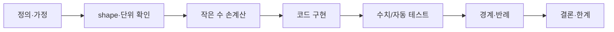
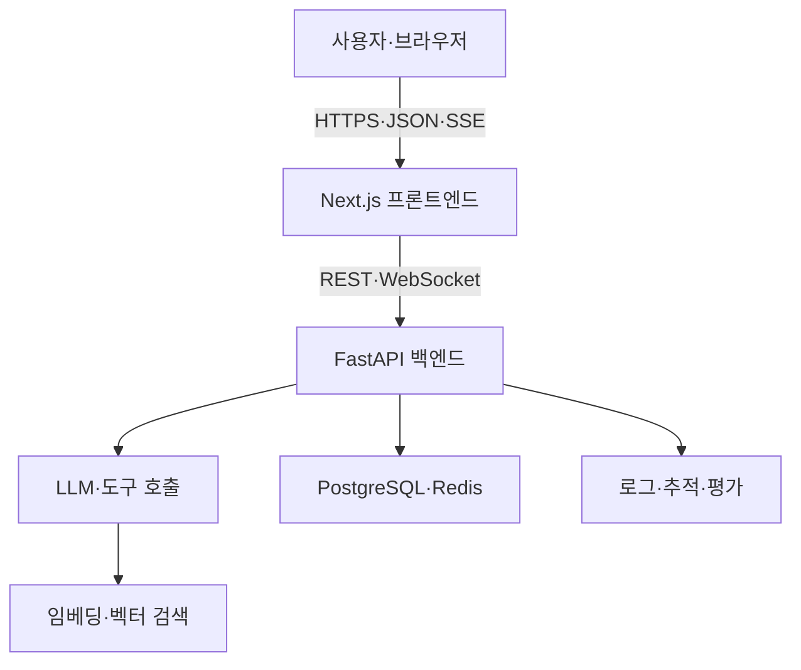

<!-- 이 파일은 Notion 로드맵을 Markdown 으로 옮긴 것이다.
     원문(수정 금지): refs/notion/로드맵_전문_20260923.md
     Notion 이 갱신되면 tools 없이 손으로 맞추지 말고 다시 변환할 것. -->

# LLM·Agentic AI 풀스택 24주 학습 로드맵
> **목표:** LLM의 원리와 코드를 이해하고, 프론트엔드·백엔드·DB·네트워크·배포·Agentic AI를 직접 연결하여 실제 앱을 만든다.

> 
  **24주 후 결과물:** Python으로 토큰화·어텐션을 구현하고, Next.js + FastAPI + PostgreSQL 기반의 스트리밍 RAG/Agent 앱을 안전하게 배포한다.

## 상세 학습 페이지 사용법

> 
  처음이라면 ‣부터 시작합니다. Python·터미널이 익숙하면 진단만 통과하고 1주차로 이동합니다.

### 매주 학습 순서
    1. 핵심 질문에 먼저 답해 본다.
    1. 이론을 읽고 용어를 내 말로 바꾼다.
    1. 수식을 작은 숫자로 손계산한다.
    1. 최소 코드를 직접 입력한다.
    1. 정상·경계·실패 테스트를 실행한다.
    1. 그래프·로그·trace를 근거로 결론을 쓴다.

### 진도 기록
    ‣
    - **이론:** 다른 사람에게 설명 가능
    - **코드:** 예제 없이 재구현
    - **검증:** 실패 사례까지 통과
    - **회고:** 선택 이유와 다음 개선 기록

### 수식·증명·코드 검증 프로토콜


1. **정의:** 기호가 무엇을 뜻하는지와 가정을 먼저 적는다.
1. **유도:** 등호 한 줄마다 사용한 법칙을 적는다.
1. **손계산:** 2×2 행렬이나 3개 토큰처럼 작은 입력으로 계산한다.
1. **수치 검증:** analytic 결과와 finite difference·brute force·기준 구현을 비교한다.
1. **반례:** 빈 입력, 0, 매우 큰 값, 잘못된 타입, 연결 끊김을 넣는다.
1. **설명:** 결과가 맞다는 사실과 왜 맞는지, 적용 한계를 분리한다.

| 단계 | 주차 | 핵심 결과물 |
|---|---|---|
| 컴퓨팅·웹 기초 | 0–4 | 터미널·Python·자료구조·네트워크·CRUD API |
| ML·LLM 원리 | 5–10 | 경사하강·역전파·tokenizer·attention·LLM API |
| 풀스택 LLM 앱 | 11–14 | Next.js UI·streaming·PostgreSQL·인증 |
| RAG·Agent | 15–20 | 검색·RAG·도구·agent loop·MCP |
| 품질·보안·배포 | 21–24 | 평가·위협 모델·CI/CD·최종 프로젝트 |

> 
  **증명보다 검증이 먼저 필요한 경우:** 수학이 막히면 작은 tensor shape와 숫자로 현상을 확인한 뒤 일반식으로 돌아옵니다. 단, 코드 결과를 증명으로 착각하지 않고 반례 가능성을 따로 기록합니다.

## 학습 운영 방식
- **주당 7~10시간:** 개념 2시간 → 따라 치기 2시간 → 직접 구현 3~5시간 → 회고 1시간
- **완료 조건:** 설명 가능 + 코드 실행 + 테스트 + 화면/로그 + README
- **학습 원칙:** 예제를 복사한 뒤 반드시 기능 하나를 바꾸고, 오류 원인과 해결 과정을 기록한다.
- **AI 활용:** 먼저 가설을 세운 다음 힌트·코드 리뷰·테스트 생성을 요청한다.

### 매주 반복 체크리스트
- [ ] 핵심 개념을 내 말로 5문장 정리
- [ ] 예제를 직접 입력하고 실행
- [ ] 미니 프로젝트 또는 기능 완료
- [ ] 테스트와 예상 결과 기록
- [ ] 오류 원인과 해결 과정 기록
- [ ] Git 커밋·README 업데이트
- [ ] 다음 주 질문 3개 작성

## 전체 시스템과 통신 흐름


**한 요청의 실제 흐름:** URL 입력 → DNS → TCP 연결 → TLS → HTTP 요청 → 서버 라우팅 → 인증 → 비즈니스 로직 → DB/LLM → SSE 응답 → 브라우저 렌더링.

## 24주 상세 로드맵

| 주제 | 주 | 개념 | 실습 | 완료 기준 |
|---|---|---|---|---|
| **개발 환경과 Python** | 1 | OS·프로세스·터미널·환경변수, 변수·조건·반복·함수 | CLI 메모 앱, Git 첫 커밋 | 터미널 실행·예외 처리·README |
| **자료구조와 알고리즘** | 2 | list/dict/set, 스택·큐, Big-O, 클래스·모듈 | 단어 빈도 분석기와 LRU 캐시 | 입력 크기별 처리시간 비교 |
| **네트워크와 웹** | 3 | IP·포트·DNS·TCP/UDP·TLS·HTTP·쿠키·JSON | curl API 호출, socket 에코 서버, 개발자도구 관찰 | 브라우저→서버 흐름 설명 |
| **백엔드 API** | 4 | REST·라우팅·상태코드·직렬화·동기/비동기 | FastAPI 메모 CRUD와 pytest | CRUD·오류 테스트 통과 |
| **ML 수학 기초** | 5 | 벡터·행렬·내적·확률·손실·경사하강법·과적합 | NumPy 선형회귀 | 학습률별 손실 해석 |
| **신경망과 PyTorch** | 6 | 활성화·역전파·batch·epoch·optimizer | 분류 모델과 train/validation | forward/backward 설명 |
| **토큰과 임베딩** | 7 | BPE·token ID·embedding·context·cosine similarity | 문자 tokenizer와 유사도 검색 | 토큰화 방식 비교 |
| **Attention·Transformer** | 8 | Q/K/V·scaled attention·mask·positional encoding | single-head attention 직접 구현 | tensor shape·causal mask 검증 |
| **LLM 학습과 추론** | 9 | pretraining·SFT·RLHF/DPO·temperature·top-p | 소형 모델 텍스트 생성 | 샘플링 결과와 환각 분석 |
| **LLM API·프롬프트** | 10 | role·structured output·tool calling·rate limit·비용 | CLI 챗봇, retry·timeout·비밀키 관리 | JSON 검증·키 유출 방지 |
| **웹 프론트 기초** | 11 | HTML·CSS·DOM·event·Promise·fetch·CORS | 채팅 UI와 FastAPI 연결 | loading/error/empty 상태 |
| **React·Next.js** | 12 | component·props·state·hook·TypeScript·렌더링 | 대화 목록·메시지·설정 패널 | 타입 오류 없는 build |
| **스트리밍 통신** | 13 | polling·SSE·WebSocket·chunk·backpressure | LLM SSE 스트리밍과 중지 버튼 | 첫 토큰 지연·끊김 처리 |
| **DB와 인증** | 14 | SQL·index·transaction·ORM·session·JWT·OAuth | PostgreSQL 대화 저장과 로그인 | 자기 대화만 조회 |
| **임베딩 검색** | 15 | chunking·embedding·top-k·metadata·vector DB | 문서 업로드→분할→검색 | chunk·top-k 품질 비교 |
| **RAG** | 16 | retrieve→augment→generate·인용·hybrid·rerank | 근거 링크가 있는 문서 Q&A | 모르면 모름·출처 표시 |
| **도구 호출** | 17 | schema·validation·권한·idempotency·오류 복구 | 계산기·모의 API·DB 검색 도구 | 잘못된 인자·실패 처리 |
| **Agentic AI** | 18 | plan/act/observe·state·memory·종료·HITL | 조사 계획과 순차 도구 호출 agent | 반복·비용 제한·승인 |
| **워크플로·멀티에이전트** | 19 | workflow와 agent 차이·supervisor·handoff | 조사자→검증자→작성자 상태 머신 | trace 저장·필요성 판단 |
| **MCP와 외부 연동** | 20 | host/client/server·resource·tool·OAuth·최소 권한 | 로컬 MCP 서버와 모의 일정/파일 도구 | 읽기/쓰기 분리·쓰기 승인 |
| **테스트·평가·관측** | 21 | unit/integration/E2E·golden set·quality·latency·cost | 30개 eval set·회귀 테스트·trace | 변경 전후 결과표 |
| **보안과 안전** | 22 | prompt injection·유출·XSS·CSRF·SQLi·secret | 검증·rate limit·allowlist·감사 로그 | 위협 모델·공격 테스트 |
| **배포와 운영** | 23 | Docker·proxy·domain·DNS·HTTPS·CI/CD | Compose 실행과 자동 테스트/배포 | 새 환경에서 재현 |
| **최종 프로젝트** | 24 | 설계·품질·운영·발표 | 개인 지식 기반 AI 업무 도우미 | 배포/녹화·문서·평가·운영 가이드 |

## 단계별 포트폴리오
1. **4주:** FastAPI 메모 CRUD — HTTP, REST, pytest
1. **10주:** CLI LLM 챗봇 — 프롬프트, 구조화 출력, 비용·오류 처리
1. **14주:** 로그인 가능한 풀스택 채팅 — Next.js, SSE, PostgreSQL, Auth
1. **16주:** 출처 기반 문서 Q&A — embedding, vector search, RAG
1. **20주:** 승인 가능한 업무 에이전트 — tools, workflow, MCP, trace
1. **24주:** 운영형 AI 앱 — 보안, 평가, Docker, CI/CD, 배포

## 최종 프로젝트: 개인 지식 기반 AI 업무 도우미

### 사용자 기능
- 계정 생성·로그인
- PDF/문서 업로드와 관리
- 출처가 표시되는 RAG 질의응답
- 토큰 단위 스트리밍 채팅
- 대화 검색과 이어하기
- 계산/검색 등 도구 2개 이상
- 외부 쓰기 작업 전 사용자 승인

### 운영 기능
- unit·integration·E2E 테스트
- 30개 이상의 golden evaluation set
- 모델·prompt 버전별 정확성·근거성·속도·비용 측정
- 로그·trace·오류 모니터링
- rate limit·tool allowlist·secret 관리
- Docker 및 자동 배포

## 권장 기술 스택
- **언어:** Python, TypeScript
- **프론트:** React, Next.js, Tailwind CSS
- **백엔드:** FastAPI, Pydantic, SQLAlchemy
- **데이터:** PostgreSQL, pgvector, Redis
- **통신:** REST, SSE, WebSocket
- **테스트:** pytest, Playwright
- **운영:** Docker, GitHub Actions, HTTPS, observability
- **중요 원칙:** 에이전트 프레임워크를 쓰기 전에 작은 agent loop를 직접 구현한다.

## GPT 프로젝트 구성

### 프로젝트 이름
**LLM·Agentic AI 풀스택 실전 학습 코치**

### GPT 프로젝트 지침
> 너는 나의 LLM·풀스택·Agentic AI 학습 코치다. 이 24주 로드맵의 현재 주차를 기준으로 가르친다. 설명은 **개념 → 왜 필요한가 → 요청/데이터 흐름 → 최소 코드 → 실행 방법 → 예상 결과 → 흔한 오류 → 확인 문제** 순서로 한다. 완성 코드를 즉시 전부 주기 전에 내가 생각할 작은 단계와 힌트를 준다. 내가 코드를 제출하면 정확성, 보안, 가독성, 테스트, 네트워크 동작 관점에서 리뷰한다. 모르는 부분은 추측하지 말고 확인 방법을 알려준다. 매 세션 끝에는 학습 요약, 완료 체크리스트, 막힌 점, 다음 행동 3개를 만든다.

### 프로젝트에 첨부할 자료
- 이 로드맵
- 프로젝트 README와 아키텍처 문서
- 주차별 회고와 에러 해결 기록
- API 명세·DB 스키마
- 평가 데이터셋과 결과

### 매일 시작 프롬프트

```plain text
현재 [N]주차이고 오늘 [시간]시간 공부할 수 있어.
지난주 완료:
막힌 내용:
오늘 목표:
내 수준을 확인하는 질문 3개를 먼저 하고,
개념 20% + 코딩 60% + 검증/회고 20%로 진행해줘.
코드는 한 단계씩 주고 매 단계 실행 결과를 확인해줘.
```

### 코드 리뷰 프롬프트

```plain text
아래 코드를 기능 정확성, 데이터 흐름, 비동기 처리, 보안,
오류 처리, 테스트 가능성 순서로 리뷰해줘.
가장 위험한 문제 → 원인 → 최소 수정 diff → 추가 테스트
→ 내 이해를 확인할 질문 순서로 답해줘.
```

### 장애 분석 프롬프트

```plain text
사실과 가설을 분리해줘.
브라우저 → 네트워크 → 백엔드 → DB/LLM 순서로
확인할 로그·명령어·기대 결과를 표로 만들고 한 단계씩 진단해줘.
```

## 저장소 구조

```plain text
ai-learning/
├─ apps/
│  ├─ web/                 # Next.js
│  └─ api/                 # FastAPI
├─ packages/shared/        # 공통 타입·스키마
├─ llm-from-scratch/       # tokenizer·attention·transformer
├─ evals/                  # 평가 데이터·스크립트
├─ docs/                   # 주차 노트·아키텍처·회고
├─ docker-compose.yml
├─ .env.example
└─ README.md
```

## 이해도 평가

| 수준 | 판정 |
|---|---|
| 1 기억 | 용어를 정의한다. |
| 2 이해 | 왜 필요한지 자신의 말로 설명한다. |
| 3 적용 | 예제 없이 작은 기능을 구현한다. |
| 4 분석 | 로그와 통신 흐름으로 오류를 찾는다. |
| 5 설계 | 보안·비용·성능 trade-off를 근거로 선택한다. |

## 첫 주 시작 체크리스트
- [ ] Python·Git·VS Code 설치와 버전 확인
- [ ] `ai-learning` Git 저장소 생성
- [ ] Python 가상환경과 의존성 파일 생성
- [ ] 파일 기반 CLI 메모 앱 구현
- [ ] 정상·빈 입력·없는 메모 테스트
- [ ] README에 실행법·구조·배운 점 작성
- [ ] GPT 프로젝트 생성 후 위 지침 등록

> 
  **1주차 종료 질문:** 터미널 명령을 입력했을 때 OS가 실행 파일을 찾아 프로세스로 실행하는 과정을 말로 설명할 수 있는가?

## 진도 조정
- Python이 처음이면 1~4주를 각각 2주로 확장한다.
- 웹 경험이 있으면 11~12주를 합치고 테스트·보안 시간을 늘린다.
- 수학에서 막히면 증명보다 작은 수와 tensor shape로 먼저 검증한다.
- 주당 5시간 미만이면 36주로 늘리되 프로젝트 범위는 유지한다.
- 라이브러리 암기보다 HTTP·상태·데이터 흐름·평가 원리를 우선한다.
24주 학습 진도  <!-- collection_view_page -->
