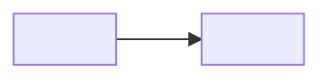

# W<NN> · <주제>

> **이번 주 결과:** <한 문장. 무엇을 할 수 있게 되는가>

| | |
|---|---|
| 주차 | <NN> / 24 |
| 단계 | <컴퓨팅·웹 기초 / ML·LLM 원리 / 풀스택 LLM 앱 / RAG·Agent / 품질·보안·배포> |
| 관문 | <해당 없음 / ★ 포트폴리오 관문 — 4수준 이상 필요> |
| 코드 위치 | `labs/w<NN>/` |

---

## 1. 선수지식과 핵심 질문

- **선수지식:**
- **핵심 질문:**

## 2. 이론을 쉽게 잡기

<!-- 읽은 것을 옮기지 말고 내 말로 쓴다. 5문장 이상. -->

## 3. 수식·유도·증명

<!-- 기호의 의미와 가정을 먼저. 등호 한 줄마다 사용한 법칙을 적는다. -->

**손계산** (작은 입력으로):

## 4. 눈으로 이해하기



## 5. 직접 구현

<!-- 예제를 복사했다면 반드시 기능 하나를 바꾼다. 무엇을 바꿨는지 적는다. -->

```python
```

**실행:**

## 6. 검증 계획

| 방법 | 검증 | 통과 기준 |
|---|---|---|
| | 정상 | |
| | 경계 | |
| | 실패 | |

## 7. 미니 프로젝트

<!-- 로드맵의 해당 주차 실습 -->

## 8. 완료 체크리스트

- [ ] 핵심 개념을 내 말로 5문장 설명
- [ ] 수식을 작은 예로 손계산
- [ ] 예제 없이 최소 기능 재구현
- [ ] 정상·경계·실패 테스트 실행
- [ ] 결과 그래프 또는 로그 첨부
- [ ] README 에 선택 이유와 한계 기록
- [ ] Git 커밋

## 9. 이해 확인

1.
2.
3.

---

## 오류 기록

| 증상 | 원인 | 해결 |
|---|---|---|
| | | |

## 회고

- **잘된 것:**
- **막힌 것:**
- **다음 주 질문 3개:**
  1.
  2.
  3.

## 완료 판정

| | |
|---|---|
| 이해도 수준 | <1 기억 / 2 이해 / 3 적용 / 4 분석 / 5 설계> |
| 판정 근거 | |
