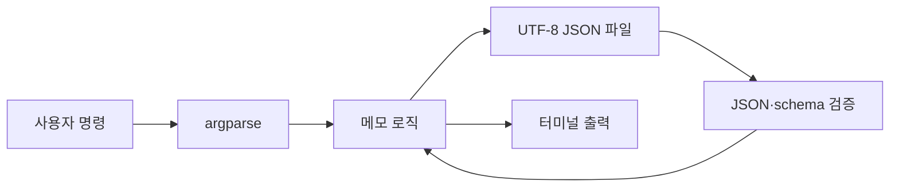

# 1주차 · 파일 기반 CLI 메모 앱

Python의 함수, 모듈, 예외, 파일 입출력을 작은 프로그램으로 연결한다.

## 준비

저장소 루트에서 실행한다.

```powershell
python -m venv .venv
Set-ExecutionPolicy -Scope Process -ExecutionPolicy Bypass
.\.venv\Scripts\Activate.ps1
python -m pip install --upgrade pip
```

시스템에서 `python`을 찾지 못하면 먼저 Python을 설치하고 새 PowerShell을 연다. 다음 명령 모두가 성공해야 한다.

```powershell
python --version
where.exe python
python -c "import sys; print(sys.executable); print(sys.prefix)"
```

## 실행

```powershell
python -m labs.week01_notes.cli add "Attention 수식 손계산"
python -m labs.week01_notes.cli list
python -m labs.week01_notes.cli search "attention"
python -m labs.week01_notes.cli delete 1
```

다른 파일로 실험하려면 하위 명령 앞에 `--db`를 둔다.

```powershell
python -m labs.week01_notes.cli --db work/demo-notes.json add "임시 메모"
```

## 테스트

외부 패키지 없이 실행:

```powershell
python -m unittest labs.week01_notes.test_notes -v
```

개발 도구 설치 후:

```powershell
python -m pip install -r requirements-dev.txt
python -m pytest labs/week01_notes -q
python -m ruff check labs/week01_notes
```

검증 범위는 파일 없음, 한글 저장, 빈 입력, 삭제, 검색, 손상 JSON, 중복 ID다.

## 데이터 흐름



저장은 같은 폴더의 임시 파일에 먼저 쓴 뒤 `replace`한다. 쓰기 도중 실패했을 때 기존 파일이 부분적으로 잘릴 가능성을 줄이기 위한 선택이다.
