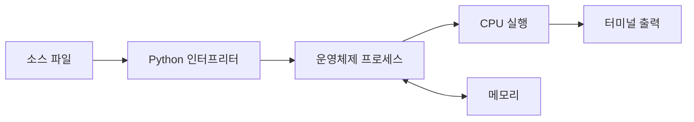

# 선수 · 선수 기초 진단과 학습 환경

> 
  **이번 주 결과:** 내 현재 수준을 수치화하고, 터미널에서 Python 프로그램을 실행하며 오류를 기록할 수 있다.

### 1. 선수지식과 핵심 질문
- **선수지식:** 없음. 컴퓨터를 처음부터 구조적으로 이해하려는 태도만 필요
- **핵심 질문:** 코드를 실행한다는 말은 CPU·메모리·운영체제 관점에서 무엇을 뜻하는가?

### 2. 이론을 쉽게 잡기
컴퓨터는 **입력 → 명령 해석 → 계산 → 메모리 저장 → 출력**을 반복한다. 소스 코드는 그대로 CPU가 읽는 것이 아니라 Python 인터프리터라는 프로세스가 읽고 실행한다. 파일은 디스크에 지속되고, 실행 중 값은 주로 RAM에 존재한다. 터미널은 운영체제에 프로그램 실행을 요청하는 인터페이스다.

### 3. 수식·유도·증명
2진수의 자릿값은 다음처럼 계산한다.
(b_k\cdots b_1b_0)_2=\sum_{i=0}^{k} b_i2^i,\quad b_i\in\{0,1\}  <!-- equation -->
예를 들어 ⁍이다. 이 원리는 정수 저장과 비트 연산의 바탕이다.

- **증명을 공부하는 방법**

### 4. 눈으로 이해하기



### 5. 직접 구현

```python
name = input("이름: ").strip()
if not name:
    raise ValueError("이름은 비어 있을 수 없습니다")
print(f"안녕하세요, {name}!")
```
`python hello.py`로 실행하고 정상 입력·빈 입력을 비교한다.

### 6. 검증 계획

  |  | 방법 | 검증 | 통과 기준 |
  |  | `python --version`, `git --version` | 환경 | 버전과 실행 경로 기록 |
  |  | 이름 입력 | 정상 | 인사 출력 |
  |  | 빈 문자열 | 실패 | 의도한 예외와 메시지 |

### 7. 미니 프로젝트
개발환경 체크 스크립트와 ‘모르는 용어 20개’ 목록을 만든다. 각 용어는 한 줄 정의·예시·아직 모르는 점으로 기록한다.

### 8. 완료 체크리스트
- [ ] 핵심 개념을 내 말로 5문장 설명
- [ ] 수식을 작은 예로 손계산
- [ ] 예제 없이 최소 기능 재구현
- [ ] 정상·경계·실패 테스트 실행
- [ ] 결과 그래프 또는 로그 첨부
- [ ] README에 선택 이유와 한계 기록

### 9. 이해 확인
1. 프로그램과 프로세스는 무엇이 다른가?
1. RAM과 디스크는 언제 각각 쓰이는가?
1. 명령어를 입력했는데 ‘찾을 수 없음’이 나오는 이유는 무엇인가?

> 
  **완료 판정:** 진단 결과와 실행 로그를 남기고, 오류 하나를 원인→가설→검증 순서로 설명한다.